# 🎨 ExcaliCraft — Where Architecture Meets Motion

<div align="center">

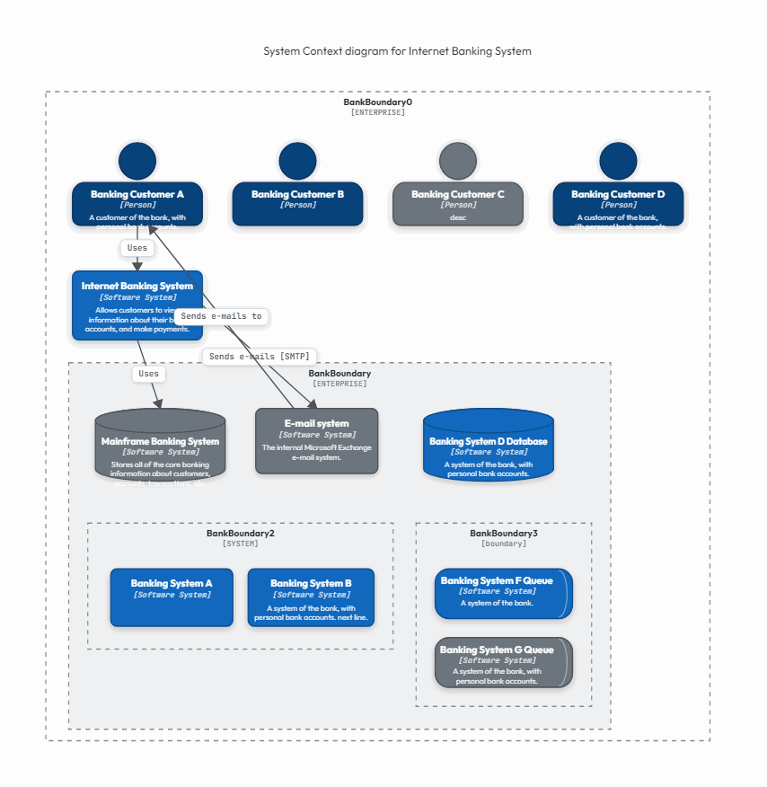

### *The Next-Generation Animated Architecture Whiteboard & Live Telemetry Studio for High-Velocity Engineering Teams.*

[](https://vitejs.dev/)
[](https://roughjs.com/)
[](https://c4model.com/)
[](#-multi-format-enterprise-export-engine)
[](#-security-privacy--performance)
[](LICENSE)

</div>

---

## 🌟 The Brand Message

> **"Static diagrams are dead on arrival. True architecture is living, pulsing, and quantifiable."**
>
> In modern distributed systems, data doesn't sit still—it streams through queues, routes across VPC subnets, faces latency hops, and saturates downstream services. **ExcaliCraft** re-imagines the classic, beloved hand-drawn whiteboard experience (inspired by Excalidraw) into an intelligent, animated architecture modeling environment where architects, engineering leads, and educators can model, simulate, analyze, and present systems in full living motion.

---

## 🚀 The Problems ExcaliCraft Resolves

| Traditional Diagramming Tools (Lucidchart, Draw.io, Static Excalidraw, Miro) | The ExcaliCraft Solution |
| :--- | :--- |
| **Dead, Static Lines**: Arrows are motionless lines that fail to communicate flow rate, directionality, or packet dynamics. | **Living Traveling Packet Animation**: Flow connectors pulse with directional packets, stepped orthogonal routing, and customizable QPS rates. |
| **Zero Architectural Telemetry**: Diagrams ignore throughput limits, latencies, and single points of failure (SPOFs) until outages hit production. | **Automated Tarjan SPOF & Graph Engine**: Instant articulation-point detection flags hidden SPOFs, calculates cumulative critical-path latencies, and alerts on saturated service capacities (150%–200%). |
| **Generic, Tedious Box-Drawing**: Users spend hours drawing generic rectangles and manually typing C4 labels. | **Native Simon Brown C4 Suite & Cloud Archetypes**: First-class Person, External Person, Software System, Container, Component, Database Cylinder, Message Queue, and Enterprise/System Boundaries ready in 1 click. |
| **Disjointed Video & Demo Creation**: Recording video walkthroughs requires complex screen recordings, timeline editing, and GIF converting tools. | **Native 60 FPS Presentation Mode & Looping GIF Studio**: One-click distraction-free presentation mode with smooth camera pan/zoom and direct export to high-fidelity animated GIFs for videos, documentation, and pull requests. |
| **Fragile File Ingestion**: Importing `.excalidraw` or SVG files into competitors loses background colors, strips embedded architecture images, or crashes on unrecognized tags. | **Bulletproof Excalidraw & Compressed SVG Engine**: Full support for native `.excalidraw` JSON and compressed deflate SVG scenes, with full image decoding and custom canvas background tinting. |

---

## 💡 One Tool Instead of Five

| You'd normally open… | In ExcaliCraft |
|---|---|
| **Excalidraw** for a hand-drawn whiteboard | Rough.js hand-drawn aesthetic, freehand pen, embedded images, authentic typography tool (`A` and `T` keys with frameless floating editor and instant click-outside commit), and lossless `.excalidraw` scene import |
| **Draw.io / Lucidchart** for architecture boxes | Architecture node cards, multi-cloud and tech icons (AWS, GCP, Azure, Kubernetes, Kafka), VPC / subnet / cluster boundaries, swimlanes, and flow-directed dominator tree SPOF intelligence |
| **A C4 tool** | Simon Brown C4 Person, External Person, System, Container, Component, Database, Queue, and Enterprise / System boundaries |
| **dbdiagram / DrawSQL** for ERDs | ERD table cards with PK/FK indicators, typed columns, **bi-directional SQL DDL** (instant reverse-engineering from `.sql` DDL files with auto-generated relationships + one-click export to PostgreSQL, MySQL, and ANSI DDL) |
| **Mermaid Live Editor** | Bidirectional Mermaid.js exchange: export active diagrams to Mermaid and import Flowchart, Sequence, C4, and State Machine syntax back onto the canvas |
| **A notes / ADR app** | **First-class Architecture Decision Records (ADRs) & Sticky Notes** directly on canvas: live Markdown rendering (`#`, `##`, `- [x]`, `` `code` ``), status badge controls (`ACCEPTED`, `PROPOSED`, `SUPERSEDED`, `REJECTED`), and auto-anchoring to architecture nodes—exported cleanly in PNG, SVG, PDF, and animated GIF |

---

## ⚡ Core Capabilities & Innovation Highlights

```
                       ┌──────────────────────────────────────────────┐
                       │           EXCALICRAFT STUDIO ENGINE          │
                       └──────────────────────────────────────────────┘
                                              │
         ┌───────────────────┬────────────────┴───────────────────┬───────────────────┐
         ▼                   ▼                                    ▼                   ▼
┌─────────────────┐ ┌─────────────────┐                  ┌─────────────────┐ ┌─────────────────┐
│  SIMON BROWN C4 │ │ QUANTITATIVE    │                  │ MULTI-CLOUD &   │ │ 60 FPS MOTION   │
│  MODEL SUITE    │ │ TELEMETRY OPS   │                  │ DATABASE ERD    │ │ & EXPORT ENGINE │
│                 │ │                 │                  │                 │ │                 │
│ • Person (Ext)  │ │ • Tarjan SPOF   │                  │ • AWS / GCP /   │ │ • Pulse Packets │
│ • Software Sys  │ │ • Path Latency  │                  │   Azure Icons   │ │ • Looping GIF   │
│ • Container App │ │ • QPS Capacity  │                  │ • VPC / Subnets │ │ • Multi-Pg PDF  │
│ • DB / Queue    │ │ • Saturation    │                  │ • PK/FK Tables  │ │ • Crisp SVG/PNG │
└─────────────────┘ └─────────────────┘                  └─────────────────┘ └─────────────────┘
```

### 1. 🏛️ Simon Brown C4 Architecture Suite
- **First-Class Primitives**: Instantly drop authentic C4 Person (`Person`), External Person (`Person_Ext`), Software System (`System`), External System (`System_Ext`), Container (`Container`), Component (`Component`), Relational Database Cylinder (`ContainerDb`/`SystemDb_Ext`), and Message Queue / Event Bus (`SystemQueue`).
- **Boundaries with Hierarchy**: Dedicated C4 Enterprise Boundaries (`[ENTERPRISE]`) and System Boundaries (`[SYSTEM]`) with authentic Simon Brown styling and line dash control.
- **Dedicated C4 Inspector**: Live-edit title, description, shape morphing (Person, System, Database, Queue), external toggle, type tags, and curated C4 color palettes (Deep Navy `#08427b`, C4 Blue `#1168bd`, Sky `#438dd5`, Muted Grey `#6c757d`).

### 2. ⚡ Quantitative Flow Simulation & Tarjan Graph Intelligence
- **Automated SPOF Detection**: Uses Tarjan’s articulation points algorithm on the active architecture graph to detect and highlight single points of failure in bright warning crimson (`#e03131`) with pulsing beacon rings.
- **Critical Path Latency Calculator**: Accumulates hop-by-hop network delays and service processing latencies (e.g. `Client (5ms) + Hop (10ms) + Gateway (15ms) + Hop (20ms) + Service (25ms) = 75ms E2E`).
- **Saturated Capacity Overload Warnings**: Computes inflow QPS against service capacity thresholds; alerts with live utilization badges when a node is operating at 150% or 200% saturation.

> **💡 Flow Simulation Disclaimer**: The flow overlay is an interactive visual simulation aid computed from user-configured parameters (QPS, hop latency, and capacity thresholds). It is designed for system design visualization, architectural reviews, and capacity planning—not live APM monitoring or load testing.

### 3. ☁️ Multi-Cloud & Network Enclosures
- **Rich Cloud Iconography**: Built-in SVG vector icons for AWS (Lambda, S3, EC2, RDS, DynamoDB, API Gateway, CloudFront, SQS, CloudWatch), Google Cloud (Cloud Run, GCS, BigQuery, Pub/Sub, GKE, Cloud SQL), Azure (App Service, Functions, Blob, Cosmos DB, AKS, Event Grid), and Modern Tech (Docker, Kubernetes, Kafka, Redis, Postgres, MongoDB).
- **Network Boundaries**: Cloud VPCs, Public DMZ Subnets, Private App Subnets, and Kubernetes Clusters with CIDR block annotations (`10.0.0.0/16`) and customizable border styles (solid, dashed, dotted).

### 4. 🗄️ Relational Database Schema & ERD Studio
- **Table Cards**: Model relational databases with Primary Keys (`[PK]`), Foreign Keys (`[FK]`), column data types (`UUID`, `VARCHAR`, `BIGINT`, `TIMESTAMP`), and table classifications (`BASE TABLE`, `VIEW`, `PARTITIONED`).
- **Dynamic Column Editor**: Add, reorder, or delete columns with live height auto-scaling and accent color swatches.

### 5. 🔄 Comprehensive UML & Software Engineering Workflows
- **Sequence Diagrams**: Complete with participants, vertical lifelines, activation boxes, synchronous requests, and asynchronous replies.
- **State Machine Diagrams**: Initial states (`●`), normal states with entry/do/exit actions, composite states, and final states (`◉`).
- **Decision Trees & Flowcharts**: Process action pills, decision diamonds (`◇`), fork bars, and join bars with condition labeling.

### 6. 🎬 Video Production, Animated GIF & Multi-Format Export
- **Looping Animated GIF**: Generates 16-frame buttery smooth looping animated GIFs directly in the browser—ideal for video editing, presentations, documentation, and pull requests.
- **Skia-Grade Multi-Page PDF**: Automatically calculates optimal orientation and executes clean vector page slicing.
- **Clean SVG & PNG**: Embedded Google Fonts (`Outfit`, `Caveat`, `JetBrains Mono`) ensuring universal font rendering on any computer or mobile device.
- **Excalidraw Native & Compressed SVG Ingestion**: Full support for native `.excalidraw` JSON and compressed deflate SVG scenes, with full image decoding and custom canvas background tinting.
- **🔄 Auto-Save & Session Restore**: Seamless 600ms debounced local-storage autosave ensures your canvas state and custom node layouts survive unexpected browser closes or page refreshes.

#### 🔄 Complete Import & Export Capabilities Matrix

| Format | Export | Import | Details & Notes |
|---|:--:|:--:|---|
| **PNG** | ✅ | ✅ | Full canvas or active selection export; drag-and-drop image import (includes full ADR & sticky note rendering) |
| **SVG** | ✅ | ✅ | Clean vector markup with embedded fonts and sanitization; extracts embedded `.excalidraw` deflate scenes |
| **Multi-Page PDF** | ✅ | ❌ | Auto-calculated orientation and vector page slicing via jsPDF |
| **Animated GIF** | ✅ | ✅ | 16-frame buttery looping pulse animation via gifenc with real-time packet telemetry |
| **Native Scene JSON** | ✅ | ✅ | Complete scene graph serialization, re-hydration, and autosave state restoration |
| **.excalidraw JSON** | ❌ | ✅ | Direct drag-and-drop scene ingestion with color, font, and element mapping |
| **Images (PNG, JPG, WebP, GIF)** | ❌ | ✅ | Multi-image placement on canvas with proportional resize handles |
| **Mermaid.js** | ✅ | ✅ | Flowchart, Sequence, C4, and State Machine syntax bidirectional import/export |
| **SQL DDL** | ✅ | ✅ | **Bi-directional:** One-click export to PostgreSQL, MySQL, and ANSI DDL; drag-and-drop or modal import of `.sql` DDL files with automated table layout and PK/FK arrow generation |
| **Markdown Notes & ADRs** | ✅ | ✅ | First-class ADR decision cards with status badges and component-anchored sticky notes with Markdown formatting, rendered directly on canvas and exported in PNG, SVG, PDF, and animated GIF |

---

## 🖼️ Complete Interactive Template Showcase

Below are animated demonstrations of all **18 built-in production templates**, rendered directly from the ExcaliCraft engine.

---

### 1. 🏛️ C4 System Context Diagram
*Simon Brown Standard — High-level actors, enterprise boundaries, banking core, external payment providers, and queues.*


- **What it showcases**: Person vs External Person personas, Enterprise & System boundary enclosures, Software Systems, External Mainframe Core, and Database cylinders with white typography and type tags.
- **Motion**: Data traffic streams from banking customers into the web and mobile systems, fanning out into core ledgers and third-party credit services.

---

### 2. 🏛️ C4 Container Architecture Diagram
*Simon Brown Standard — Container breakdown of Single-Page Apps, Mobile Clients, API Applications, and Micro-Databases.*

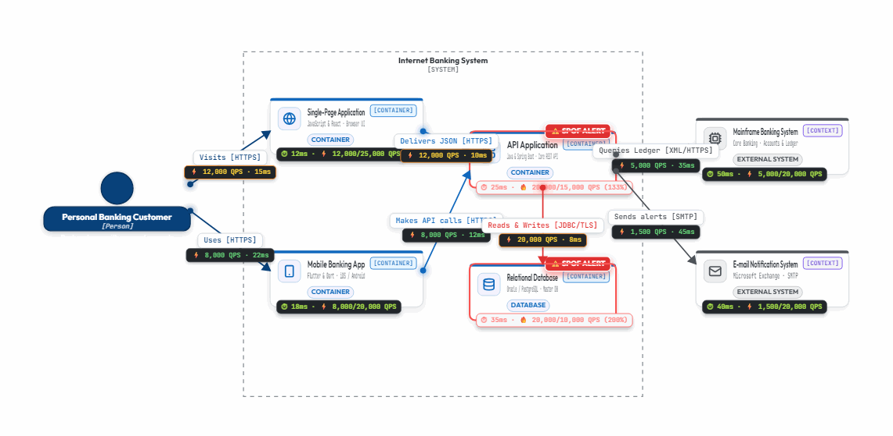

- **What it showcases**: Single-Page React app, Flutter mobile client, Spring Boot API application (marked with SPOF analysis), and PostgreSQL database containers.
- **Motion**: Traveling pulse arrows routing between frontend clients and backend APIs with latency hops.

---

### 3. ⚡ High-Concurrency Flash Sale Architecture
*Black Friday / High-QPS concurrency modeling with Edge CDN, WAF, API Gateways, Kafka, and Redis caching.*

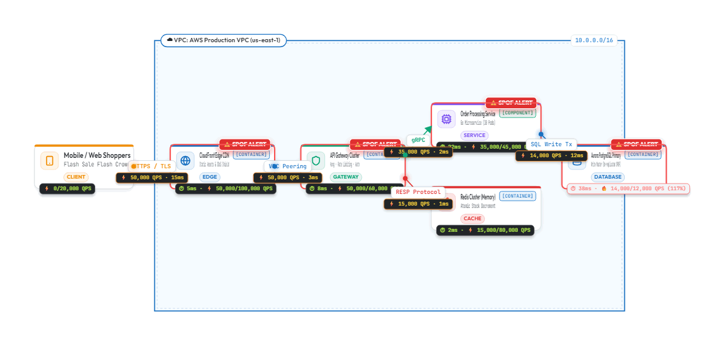

- **What it showcases**: Edge caching, distributed rate-limiting, write-behind caching with Redis, order ingestion into Kafka, and inventory database protection.
- **Motion**: Live telemetry ops simulation highlighting high throughput QPS and saturated bottleneck detection.

---

### 4. 🌐 Multi-Region Global High Availability
*Cross-region active-active deployment with Anycast DNS, Primary and Secondary VPCs, and asynchronous database replication.*

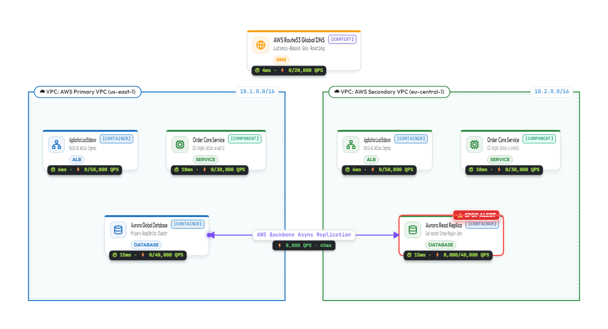

- **What it showcases**: Anycast routing, multi-region VPC enclosures, health check failover, and global cross-region data replication.
- **Motion**: Synchronous local flows alongside cross-region animated packet streaming between primary and secondary storage replicas.

---

### 5. 🔒 Fintech PCI-DSS Compliant Banking VPC
*Segmented cloud architecture with Public DMZ, Private Application Subnets, Database Enclosures, and HSM Vault.*

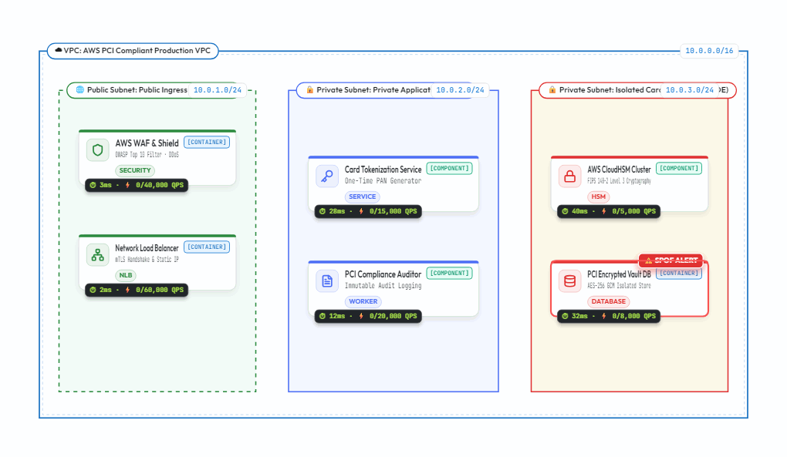

- **What it showcases**: Strict network segmentation with CIDR blocks (`10.0.1.0/24`, `10.0.2.0/24`), tokenization proxies, audit loggers, and hardware security module vaults.
- **Motion**: Secure ingress flows traversing WAF proxies into isolated private processing clusters.

---

### 6. ☁️ AWS Cloud-Native Serverless Architecture
*Event-driven serverless system on Amazon Web Services.*

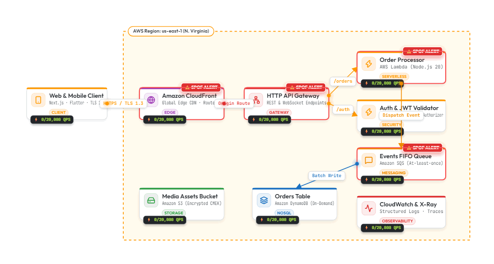

- **What it showcases**: Route 53, CloudFront CDN, API Gateway, AWS Lambda serverless execution, DynamoDB NoSQL storage, SQS queues, and S3 object buckets.
- **Motion**: Event-driven pulses triggered from user requests through Lambda microservices to distributed managed datastores.

---

### 7. 🤖 Google Cloud Data & AI Pipeline
*Modern streaming data analytics and machine learning pipeline on Google Cloud Platform.*

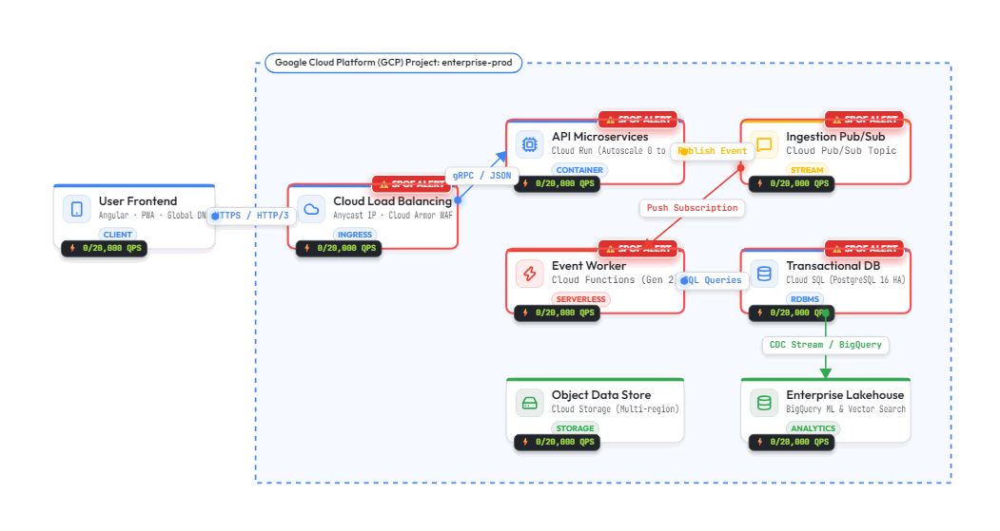

- **What it showcases**: Cloud DNS, Cloud Run microservices, Cloud Pub/Sub event streams, BigQuery serverless warehouse, Vertex AI model endpoints, and Cloud Storage lakes.
- **Motion**: Streamed telemetry moving continuously from ingestion topics into real-time analytics and predictive AI models.

---

### 8. 🏢 Azure Enterprise Multi-Tier Architecture
*Scalable multi-tier enterprise architecture on Microsoft Azure.*

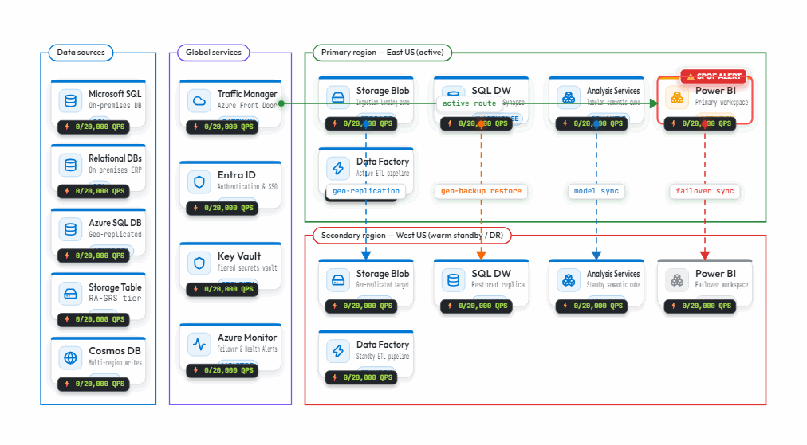

- **What it showcases**: Azure Front Door global routing, Azure App Services, Azure Kubernetes Service (AKS), Cosmos DB global distribution, and Azure Event Grid.
- **Motion**: Multi-tier request lifecycles moving from edge ingress through container orchestrators to distributed document stores.

---

### 9. 📨 Event-Driven Microservices Architecture
*Decoupled microservices coordinated via an asynchronous event bus.*

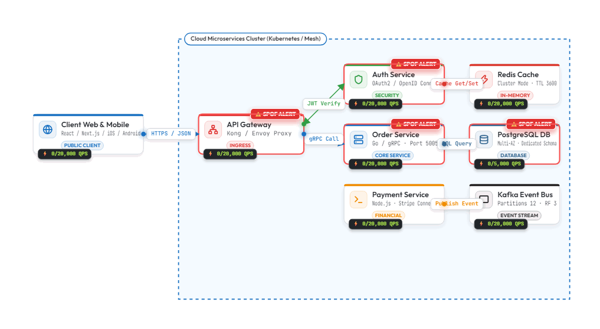

- **What it showcases**: API Gateway routing, Order Service, Payment Service, Inventory Service, and central Event Broker (Kafka/RabbitMQ) with independent service databases.
- **Motion**: Bidirectional event propagation showing asynchronous message publishing and fan-out consumer acknowledgments.

---

### 10. 🧱 Modular Monolith Architecture
*Clean modular architecture featuring isolated domain modules, internal event buses, and read/write segregation.*

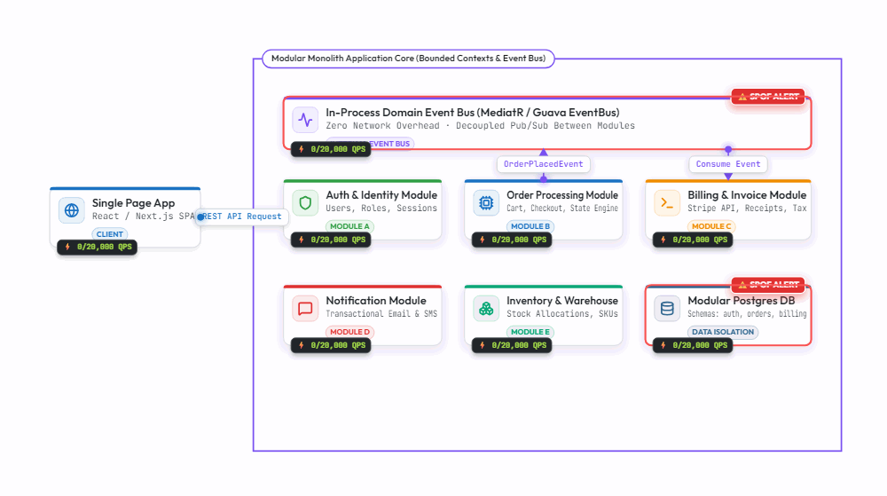

- **What it showcases**: Core Domain Modules (Billing, Accounts, Notifications), in-memory event dispatching, shared kernel, and unified relational storage.
- **Motion**: Internal synchronous interface calls and asynchronous domain event distribution.

---

### 11. 🏛️ Monolithic 3-Tier Architecture
*Classic load-balanced three-tier web application architecture.*

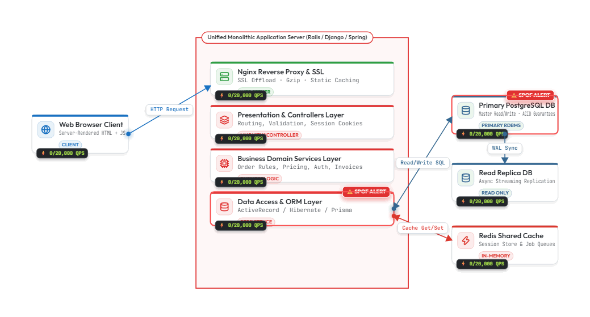

- **What it showcases**: High-availability load balancers, clustered monolithic web/application servers, and Master/Replica database replication.
- **Motion**: User web requests balanced across active application nodes with read/write split traffic to primary and secondary databases.

---

### 12. ⏱️ Distributed System Sequence Diagram
*UML Sequence modeling synchronous calls, async callbacks, activations, and error lifelines.*

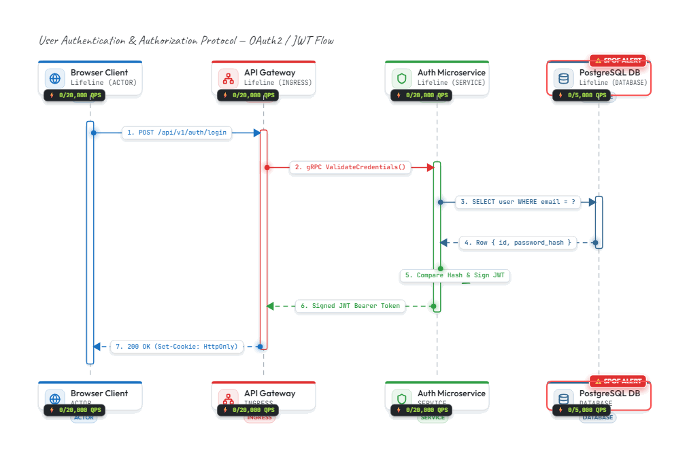

- **What it showcases**: Actors, services, vertical lifelines, activation boxes with custom heights, return messages, and flow directionality.
- **Motion**: Stepped call sequence demonstrating chronological request and response flow across distributed nodes.

---

### 13. 📊 Relational Database Schema & ERD
*Entity-Relationship Diagram with primary keys, foreign keys, and typed column definitions.*

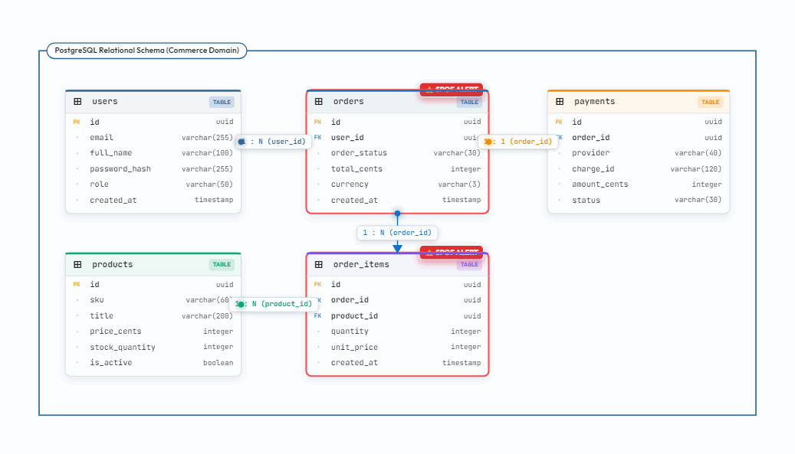

- **What it showcases**: Multiple related tables (`users`, `orders`, `order_items`, `payments`), PK/FK badges, column data types, and connecting relational links.
- **Motion**: Active relationship flows tracing referential integrity between foreign keys and parent primary keys.

---

### 14. 🔄 State Machine & Transition Model
*UML Statechart with initial states, operational states with entry/do/exit actions, and terminal states.*

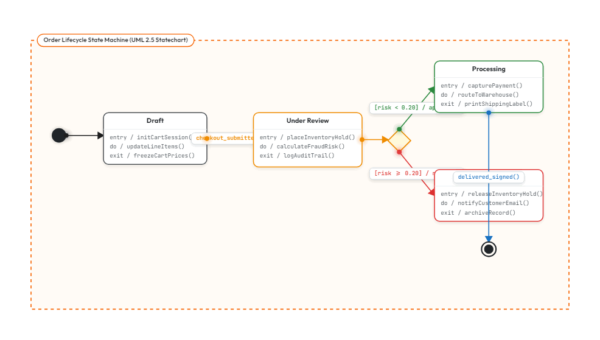

- **What it showcases**: `Initial` state (`●`), `Pending`, `Processing` (with internal action hooks), `Failed`, and `Completed` final states (`◉`).
- **Motion**: State transitions flowing dynamically along labeled condition paths.

---

### 15. 🔀 Logic Flowchart & Decision Tree
*Algorithmic flowchart with process steps, decision diamonds, and branch conditions.*

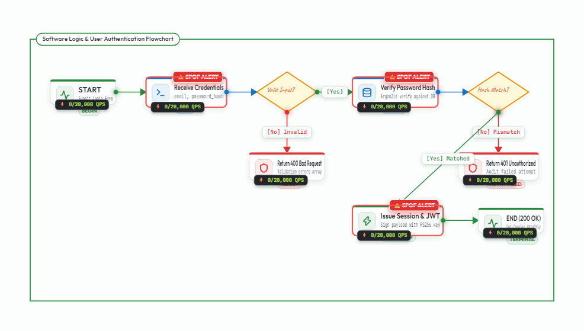

- **What it showcases**: Start/End terminators, process action cards, condition diamonds (`◇`), and labeled Yes/No branches.
- **Motion**: Algorithmic step traversal following logic branch conditions through to execution completion.

---

### 16. 📋 Business Process & Activity Flow
*Swimlane-based activity diagram modeling cross-functional team workflows.*

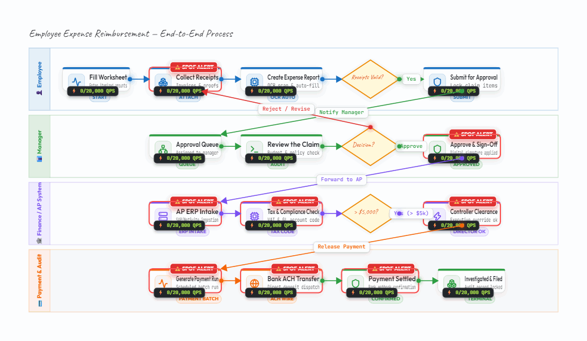

- **What it showcases**: Horizontal swimlanes (Customer, Sales, Operations), action steps, fork bars, join bars, and flow-final indicators.
- **Motion**: Workflow tokens advancing across swimlane boundaries through concurrent forks and synchronization joins.

---

### 17. 📝 Microservices Architecture with ADR Decision Cards & Sticky Notes
*Production AWS microservices topology coupled with live Architecture Decision Record (ADR) cards and component-anchored sticky notes.*

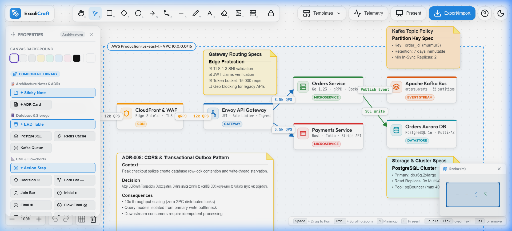

- **What it showcases**:
  - **ADR Decision Card (`ADR-008: CQRS & Transactional Outbox Pattern`)**: First-class architectural documentation card featuring an `ACCEPTED` status badge, architectural context, decision rationale, and system consequences (`Event-driven eventual consistency via Debezium CDC`).
  - **Component-Anchored Sticky Notes**: Yellow sticky notes pinned directly to nodes (e.g. `Note: Outbox Poller` pinned to Payments Service, `Note: Kafka Partitioning` pinned to Kafka Bus) featuring live Markdown parsing, including task lists (`- [x] Debezium connector configured`, `- [x] CDC stream to Kafka`, `- [ ] DLQ retry policy`).
  - **Enterprise Microservices Topology**: Kong API Gateway routing to Go Orders Service, Rust Payments Service, Kafka Event Bus, and AWS Aurora PostgreSQL.
- **Export Fidelity**: Sticky notes and ADR cards render with full fidelity directly onto the HTML5 Canvas, allowing crisp, unclipped exports in **PNG**, **SVG**, **Multi-Page PDF**, and **Animated GIF** formats.
- **Motion**: Animated live pulse packets navigate across gateway, microservices, and message brokers while ADR documentation remains pinned in place.

---

### 18. 🗄️ SQL DDL Reverse Schema Ingestion (ERD)
*Instant visual database schema reverse-engineering directly from raw `.sql` DDL migration files.*

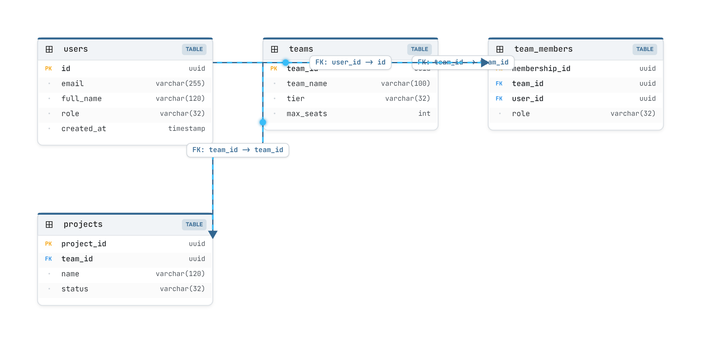

- **What it showcases**:
  - **Automated Schema Parsing**: Imports standard PostgreSQL, MySQL, and SQLite `CREATE TABLE` DDL scripts containing inline and out-of-line primary keys and foreign key constraints (`REFERENCES teams(id)`).
  - **Intelligent Relational Scaffolding**: Automatically calculates grid positions for generated table cards (`users`, `teams`, `team_members`, `projects`), assigns Primary Key (`[PK]`) and Foreign Key (`[FK]`) badges, and discovers column types (`UUID`, `VARCHAR(100)`, `TIMESTAMPTZ`).
  - **Auto-Routed Relationship Connectors**: Draws orthogonal relational arrows from foreign key child tables to parent primary key definitions with cardinality labels (`FK`).
- **Workflow**: Paste raw SQL in the import modal or drag and drop a `.sql` file onto the canvas to convert legacy migration scripts into interactive visual ERDs in seconds.

---

## 🎥 Video Production & Creator Guide

If you are creating **video tutorials, product demos, YouTube reviews, or tech conference talks** using ExcaliCraft, follow these best practices for maximum visual impact:

### 1. Presentation Mode Walkthroughs
- Press the **Present** button (`#btn-present`) in the top navigation or hit presentation shortcut.
- The UI controls smoothly fade away, leaving a pristine canvas.
- Pan and zoom across nodes using the mouse wheel or touchpad; the camera uses smooth acceleration curves ideal for 60 FPS screen capture (OBS, ScreenStudio, or Camtasia).

### 2. The "Before & After" Bottleneck Reveal
1. Start recording with **Telemetry Ops** turned **OFF** (`Ctrl + Shift + O` or toggle in toolbar). Show the diagram as a traditional clean architectural schematic.
2. Toggle **Telemetry Ops** to **ON**. Watch as:
   - SPOF nodes instantly pulse with crimson warnings.
   - Hop latencies appear on connectors.
   - Saturated services display percentage utilization badges.
3. This creates a compelling narrative transition for engineering videos: *"Here's our theoretical design... and here is what happens when 50,000 QPS hits our API gateway."*

### 3. Animated GIF Assets in Video Editors
- All GIFs in the `img/` directory are encoded at **16-frame clean pulse intervals** that loop seamlessly on video timelines.
- Drop them directly into **DaVinci Resolve**, **Premiere Pro**, or **Final Cut Pro** as looping motion overlays or picture-in-picture graphics.

---

## 📊 Feature Comparison Matrix

| Feature | ExcaliCraft | Excalidraw | Lucidchart | Eraser.io |
| :--- | :---: | :---: | :---: | :---: |
| **Hand-Drawn Rough.js Aesthetic** | ✅ | ✅ | ❌ | ❌ |
| **Crisp Modern Architecture Cards** | ✅ | ❌ | ✅ | ✅ |
| **Traveling Animated Packet Flows** | ✅ | ❌ | ❌ | ❌ |
| **Live SPOF Detection (Tarjan Algorithm)** | ✅ | ❌ | ❌ | ❌ |
| **Flow-Directed Dominator Tree SPOF** | ✅ | ❌ | ❌ | ❌ |
| **End-to-End Path Latency Calculator** | ✅ | ❌ | ❌ | ❌ |
| **Capacity Saturation (QPS Overload) Alerts** | ✅ | ❌ | ❌ | ❌ |
| **C4 Model Primitives (Person, Ext, DB, Queue)** | ✅ | ❌ | Partial | Partial |
| **Cloud Icons (AWS, GCP, Azure, Tech)** | ✅ (Native) | Libraries | Libraries | Limited |
| **ERD Tables with PK/FK & Column Manager** | ✅ | ❌ | ✅ | ✅ |
| **Bi-Directional SQL DDL (Export & Reverse Import)**| ✅ | ❌ | Export only | Export only |
| **Architecture Decision Records (ADR) Cards** | ✅ | ❌ | ❌ | Partial |
| **Component-Anchored Sticky Markdown Notes** | ✅ | ❌ | ❌ | Partial |
| **Authentic Floating Text Tool ('A' / 'T')** | ✅ | ✅ | ❌ | ❌ |
| **Sequence Lifelines & Activation Boxes** | ✅ | ❌ | ✅ | ✅ |
| **Native Looping Animated GIF Export** | ✅ | ❌ | ❌ | ❌ |
| **Excalidraw Native & Compressed SVG Ingestion** | ✅ | ✅ | ❌ | ❌ |
| **100% Client-Side Private (Zero Cloud Leaks)** | ✅ | ✅ | ❌ | ❌ |

---

## ⌨️ Keyboard Shortcuts Cheatsheet

| Action | Shortcut |
| :--- | :--- |
| **Select / Transform Tool** | `V` or `1` |
| **Hand / Pan Canvas** | `H` or `Space + Drag` |
| **Rectangle / Architectural Card** | `R` or `2` |
| **Decision Diamond ◇** | `D` or `3` |
| **Ellipse / Circle** | `C` or `4` |
| **Flow Arrow Connector** | `A` or `5` |
| **Elbow (Stepped) Arrow** | `O` or `Shift + A` |
| **Draw / Freehand Pen** | `P` or `7` |
| **Text Tool** | `T` or `8` |
| **Architecture Service Node** | `N` or `0` |
| **Insert Image / Diagram** | `I` |
| **Toggle Properties Inspector** | `\` or `Ctrl + B` |
| **Toggle Telemetry Ops Overlay** | `Ctrl + Shift + O` |
| **Quick Zoom to Fit** | `Shift + 1` |
| **Zoom 100%** | `Shift + 0` |
| **Undo / Redo** | `Ctrl + Z` / `Ctrl + Y` |
| **Duplicate Selected** | `Ctrl + D` |
| **Quick Save / Export SVG** | `Ctrl + S` |

---

## 🛠️ Getting Started & Local Development

### Prerequisites
- [Node.js](https://nodejs.org/) (version 18 or higher recommended)
- `npm` or `pnpm` or `yarn`

### Installation
```bash
# Clone the repository
git clone https://github.com/ahmedemad3/excalicraft.git

# Navigate into the project directory
cd excalicraft

# Install dependencies
npm install

# Start the local development server
npm run dev
```

The application will launch on `http://localhost:5174/` with instant hot-module replacement (HMR).

### Production Build
```bash
# Validate and build the production bundle
npm run build

# Preview the built distribution
npm run preview
```

### Running Automated Tests
```bash
# Run all automated verification suites
npm test
```

### Regenerating README Template GIFs (Contributors)
The development server includes a helper endpoint (`/api/save-gif`) for automated asset capture:
```bash
npm run dev       # Start the local development server
```
Open your browser at `http://localhost:5174/`, open the DevTools Console, and run:
```javascript
generateAllTemplateGifs()
```

> **🔒 Security Caution:** The `/api/save-gif` endpoint is a development-mode convenience only and is disabled in production builds. Do not run the development server with `--host` on untrusted networks.

---

## ⚠️ Known Limitations

ExcaliCraft is actively developed. Please review our current functional boundaries:

- **SQL Schema Scope**: The SQL DDL reverse-engineering engine supports standard ANSI, PostgreSQL, MySQL, and SQLite `CREATE TABLE` syntax, column datatypes, primary keys, and foreign keys. Advanced vendor-specific procedural triggers, stored procedures, and complex custom partitioning clauses are safely skipped during visual ERD generation.
- **RTL Typography**: Right-to-left (Arabic/Hebrew) bidirectional text flow on canvas is on the active roadmap for upcoming releases.
- **Live APM Streaming**: The flow simulation overlay calculates quantitative metrics from user-configured architectural thresholds; live streaming OpenTelemetry WebSocket ingestion is planned for future releases.
- **Excalidraw Ingestion Scope**: Ingests standard `.excalidraw` JSON and compressed SVG payloads with high fidelity; proprietary third-party canvas extensions outside standard Excalidraw types are sanitized to standard shapes.

---

## 🗺️ Roadmap & Sprint Milestones

### Completed in Sprint 8 (v1.2 Architecture Notes & Schema Ingestion) 🟢
- [x] **SQL DDL → ERD Reverse Parser**: Drag-and-drop or modal import of `.sql` schema files (`CREATE TABLE`, inline and out-of-line `FOREIGN KEY`, `REFERENCES`) to automatically scaffold interactive table cards with auto-routed PK/FK links.
- [x] **First-Class Markdown Notes & ADR Cards**: Dedicated rich Architecture Decision Record (ADR) cards with status badges (`ACCEPTED`, `PROPOSED`, `SUPERSEDED`, `REJECTED`) and component-anchored sticky notes with live Markdown formatting (`#`, `##`, `- [x]`, `` `code` ``), rendered directly on canvas and exported in SVG, PDF, PNG, and looping GIF.
- [x] **Directed Dominator Tree SPOF**: Flow-directed Lengauer-Tarjan dominator tree analysis with entry-point root detection, reachable blast-radius impact highlighting, and cycle tolerance.
- [x] **Authentic Excalidraw Text Tool & Hotkey**: Letter `A` hotkey support, frameless floating canvas textarea, instant click-outside commit, and dynamic bounding-box auto-sizing.

### Completed in Sprint 7 (v1.1 Hardening) 🟢
- [x] **Critical-Path Latency Engine**: Rewrote path traversal to DFS longest-path algorithm with cycle detection and depth bounds; accurately calculates multi-branch bottlenecks.
- [x] **Mermaid Import Hardening**: Full support for chained edges (`A --> B --> C`), `subgraph ... end` group boundaries, `stateDiagram-v2`, and non-blocking per-line warning recovery.
- [x] **Explicit Node Roles & Replicas**: Added native `role` (`entry`, `service`, `datastore`, `queue`, `cache`) and `isReplicated` attributes to eliminate title-based SPOF false positives.
- [x] **Capacity Saturation Visibility**: Unconfigured nodes clearly indicate missing thresholds; templates updated with tuned capacities demonstrating live 175% saturation alerts.
- [x] **Developer Server Security Hardening**: Secured `/api/save-gif` dev endpoint with `path.basename()` traversal stripping, `.gif`/`.png` extension allowlist, and 20MB streaming payload limit.
- [x] **Automated CI/CD & Unified Test Runner**: Unified `npm test` script executing 11 test suites with 100% pass rate; GitHub Actions CI workflow on every push/PR.
- [x] **Open Source Licensing**: Standard MIT License added to repository root.

### Upcoming Milestones (Sprint 9+) 🗓️
- [ ] **Arabic & RTL Canvas Typography**: Native bidirectional text layout and font rendering for right-to-left architectural documentation.
- [ ] **OpenTelemetry Live Stream Ingestion**: Live trace and metrics visualization streaming over WebSockets into animated canvas packet flows.
- [ ] **Multi-User Realtime Collaboration**: CRDT-based WebRTC peer-to-peer live cursor and element synchronization.

---

## 🏗️ Codebase Architecture

```
excalicraft/
├── index.html              # Studio workspace, toolbars, left property inspector, quick add palettes
├── vite.config.js          # Vite build configuration with automated /api/save-gif middleware
├── src/
│   ├── main.js             # Studio controller, selection manager, inspector bindings, state machine
│   ├── renderer.js         # Canvas rendering engine (Rough.js + Crisp vector cards, C4, boundaries)
│   ├── graph.js            # Architecture graph intelligence (Tarjan & Dominator Tree SPOF, latency, capacity)
│   ├── templates.js        # 18 production architecture templates (C4, Cloud, Microservices, ERD, ADR Notes)
│   ├── export.js           # Multi-format export engine (GIF, SVG, PNG, PDF, Excalidraw JSON)
│   ├── math.js             # Geometric collision, bounding box calculations, hit testing, viewport
│   ├── history.js          # Undo / redo historical stack manager
│   ├── icons.js            # Lucide & Cloud architecture icon registry (AWS, GCP, Azure, Tech)
│   ├── presenter.js        # Fullscreen presentation mode with smooth camera choreographer
│   ├── minimap.js          # Live interactive viewport overview navigator
│   ├── codegen.js          # SQL DDL export & reverse-engineering parser (CREATE TABLE -> ERD)
│   └── mermaid.js          # Mermaid.js & PlantUML bidirectional diagram converter
├── img/                    # High-fidelity looping animated GIFs and screenshots for all 18 templates
├── doc/                    # Architectural specs, handoffs, test scenarios, and issues log
└── tests/                  # Automated verification and quality assurance test suites (12 suites)
```

---

## 🔒 Security, Privacy & Performance

- **Zero Cloud Leakage**: 100% of your architecture diagrams, confidential network topologies, and schema keys remain inside your local browser runtime. No diagrams are ever sent to an external server.
- **Hardware-Accelerated Canvas**: Custom dirty-rectangle tracking and cached rough drawables ensure 60 FPS silky smooth rendering even on complex enterprise topologies with hundreds of elements.
- **High-DPI Retina Ready**: Automatic supersampling ensures crystal-clear rendering on Apple Retina and 4K UHD monitors.

---

## 📜 License

ExcaliCraft is open-source software licensed under the **MIT License**.


---

<div align="center">

**Built with passion for software architects, systems engineers, and visual thinkers.**

*Transform your static diagrams into living, animated architecture.*

</div>
